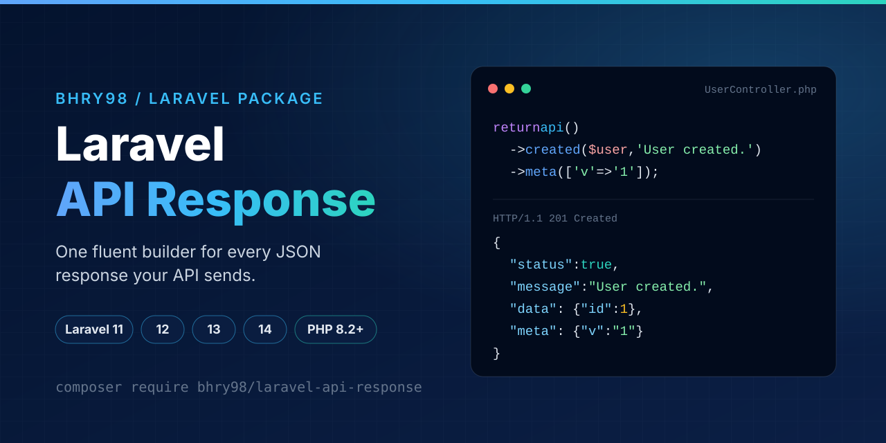

<p align="center">
  <a href="https://bhry98.github.io/packages/laravel-api-response/">
    
  </a>
</p>

<p align="center">
  <a href="https://packagist.org/packages/bhry98/laravel-api-response"></a>
  <a href="https://github.com/bhry98/laravel-api-response/actions/workflows/tests.yml"></a>
  <a href="https://packagist.org/packages/bhry98/laravel-api-response"></a>
  <a href="https://packagist.org/packages/bhry98/laravel-api-response"></a>
</p>

# Laravel API Response

A fluent, extensible API response toolkit for **Laravel 11, 12, 13 and 14**. Every response your API sends (success, error, validation, pagination, resources) comes out in the same configurable JSON envelope. It works with zero configuration, and you can customize it as far as you need.

```bash
composer require bhry98/laravel-api-response
```

```php
return api()->created($user);

return api()
    ->success()
    ->message('User created.')
    ->data($user)
    ->meta(['version' => 'v1'])
    ->send();
```

```json
{
    "status": true,
    "message": "User created.",
    "data": { "id": 1, "name": "Jane" },
    "meta": { "version": "v1" }
}
```

**Highlights:** ready-made HTTP and business shortcuts, automatic handling of models/resources/paginators, renameable keys and swappable presets (`default`, `minimal`, `mobile`, `jsonapi`), opt-in exception rendering, rate limiting, audit logging and locale resolution, plus hooks, events, macros and testing assertions.

## 📖 Documentation

**Read the full documentation at [bhry98.github.io/packages/laravel-api-response](https://bhry98.github.io/packages/laravel-api-response/)**. It covers installation, every response helper, configuration, and every extension point.

For more packages, visit **[bhry98.github.io/packages](https://bhry98.github.io/packages/)**.

## License

MIT. See [LICENSE](LICENSE).
